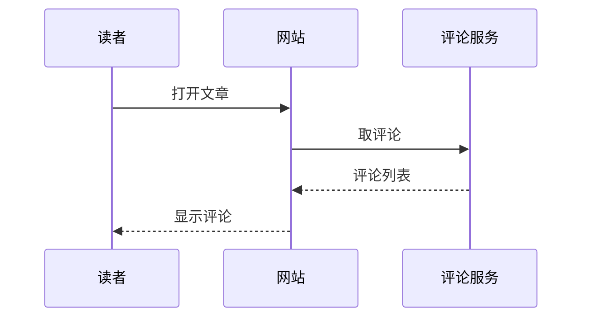

这篇文章把网站支持的写法都用了一遍，每种写法再加上几种常见的变化：嵌套、很长的内容、不写标题、取不到数据。它是草稿：首页、站内搜索、RSS 和站点地图里都没有，只能用链接打开，也不让搜索引擎收录。想发布就把 `draft` 改成 `false`。每种写法怎么写，见 Obsidian 里的《文章扩展写法》。

## 文字

普通段落里可以有**粗体**、*斜体*、***粗斜体***、~~删除线~~、`行内代码`、[站内链接](/about)和[外部链接](https://astro.build)。外部链接后面有一个箭头，在新标签页打开。**粗体里也可以有[链接](/about)和`代码`**。

页面在服务器上生成，也就是 :term[SSR]{note="Server-Side Rendering"}；构建时先生成好的叫 :term[SSG]{note="Static Site Generation"}。凶手是:spoiler[管家]，帮凶是:spoiler[那位从来不说话的园丁]。这一句后面有一个脚注[^1]，这一句有第二个[^long]。

中英文混排：Astro 7 用 Vite 构建，`pnpm build` 之后的文件在 `dist/` 里。English text sits in the same paragraph, and a whole English paragraph follows.

The quick brown fox jumps over the lazy dog. This paragraph is English only, to check the Latin font, its line height and how the measure feels when the words are longer than Chinese characters.

一个很长、中间没有空格的网址也要能折行：https://article.rottenth.cafe/blog/000000?utm_source=example&utm_medium=a-very-long-query-string-that-keeps-going-and-going

一个很长的行内代码也一样：`const configuration = await loadConfiguration({ root: process.cwd(), mode: "production" });`

> 引用块。Make the small decisions once, then stop deciding.

> 多段的引用块。第一段。
>
> 第二段，里面有**粗体**和`代码`。
>
> > 引用里再套一层引用。
>
> — 署名写在最后一行

---

## 标题

### 三级标题

#### 四级标题

四级标题不进目录，旁边也有 “#” 锚点。

##### 五级标题

###### 六级标题

## 列表

- 无序列表的第一项
- 第二项，这一项比较长，长到会折成两行，用来看折行之后的文字和圆点怎么对齐，以及行距是不是和正文一样
  - 第二层
    - 第三层
      - 第四层
- 第三项

1. 有序列表的第一项
2. 第二项
   1. 有序里套有序
   2. 第二个
3. 第三项
   - 有序里套无序

不从 1 开始编号的列表（紧跟在另一个有序列表后面时会被并进去，所以中间隔了这一句）：

5. 第一项是 5
6. 下一项是 6

- 一项里有几段的列表

  这是第一项的第二段，缩进和第一行对齐。

  ```sh
  pnpm dev
  ```

- 第二项

- [x] 已完成的任务
- [ ] 没完成的任务
- [ ] 一个很长的任务，长到会折成两行，用来看复选框和第二行文字的对齐
  - [x] 嵌套的子任务
  - [ ] 另一个子任务

## 提示块

:::note
`note`：补充说明，不看也不影响。
:::

:::tip[自定义标题]
`tip`：带自己的标题。
:::

:::important
`important`：读者需要知道的事。
:::

:::warning
`warning`：可能出问题的地方。
:::

:::caution
`caution`：会造成损失的操作。
:::

:::note[里面有列表和代码]
提示块里可以放别的写法：

1. 先运行：

   ```sh
   pnpm install
   ```

2. 再看 [README](/about)。

| 列 | 说明 |
| --- | --- |
| A | 表格也行 |
:::

::::tip[提示块里套提示块]
外层四个冒号，里层三个。

:::warning
里面这一个是 `warning`。
:::
::::

:::details[点开看完整内容]
`details` 默认收起。加 `{open}` 就一开始展开。
:::

:::details[一开始就展开的折叠块]{open}
这一块写了 `{open}`。

```json
{ "open": true }
```
:::

:::spoiler
整段剧透，点一下才显示。
:::

:::spoiler
剧透里也可以有列表：

- 第一条线索
- 第二条线索
:::

## 代码

```ts title="astro.config.ts" {3} showLineNumbers
import { defineConfig } from "astro/config";

export default defineConfig({
  site: "https://rottenth.cafe", // [!code ++]
  trailingSlash: "ignore" // [!code --]
});
```

不写文件名、不显示行号的代码块：

```js
const greeting = "hello";
console.log(greeting);
```

高亮几段不连续的行（`{1,4-5}`）：

```py {1,4-5}
import os

def main():
    path = os.getcwd()
    print(path)

main()
```

一行很长的代码，横向滚动，不折行：

```sh
pnpm --filter article exec astro build --site https://article.rottenth.cafe --outDir ./dist/a/very/long/output/directory/name
```

超过 12 行的代码块一开始折叠，只显示前 10 行：

```ts title="astro.config.ts"
import mdx from "@astrojs/mdx";
import sitemap from "@astrojs/sitemap";
import { defineConfig } from "astro/config";
import {
  markdown,
  rehypeDsExternalLinks,
  rehypeDsHeadingAnchors,
  shikiTransformers
} from "@rottensea/ds-personal-website/markdown";

export default defineConfig({
  site: "https://article.rottenth.cafe",
  trailingSlash: "never",
  build: { format: "file" },
  integrations: [mdx(), sitemap()],
  markdown: {
    remarkPlugins: [markdown],
    rehypePlugins: [rehypeDsHeadingAnchors, rehypeDsExternalLinks],
    shikiConfig: {
      transformers: shikiTransformers()
    }
  }
});
```

不认识的语言，或者纯文字：

```text
纯文字的代码块，没有语法高亮。
    缩进保留。
```

```diff
- trailingSlash: "ignore"
+ trailingSlash: "never"
```

:::code-group{sync="pkg"}
```sh title="pnpm"
pnpm add astro
```

```sh title="npm"
npm install astro
```

```sh title="yarn"
yarn add astro
```
:::

:::code-group{sync="pkg"}
```sh title="pnpm"
pnpm dev
```

```sh title="npm"
npm run dev
```

```sh title="yarn"
yarn dev
```
:::

上面两个代码组的 `sync` 相同，切换一个，另一个跟着切。下面这个没写 `sync`，自己切自己的，两个标签里的语言也不同：

:::code-group
```ts title="TypeScript"
export const add = (a: number, b: number): number => a + b;
```

```py title="Python"
def add(a: int, b: int) -> int:
    return a + b
```
:::

:::file-tree{label="你的项目"}
- src/
  - pages/
    - index.astro
  - content.config.ts  新加的
- astro.config.ts
:::

:::file-tree
- sites/  三个站
  - article/
    - src/
      - content/
        - blog/
          - 000000/
            - index.mdx  这篇文章
            - cover.jpg
          - 000001/
            - index.mdx
      - layouts/
        - BaseLayout.astro
    - package.json
  - archive/
  - home/
- pnpm-workspace.yaml
:::

## 步骤

:::steps{current=1}
1. 复制模板文件夹

   每一步的第一行是标题，后面是说明，可以放代码和图片。

2. 改配置

3. 构建并部署
:::

不写 `current` 就是普通的编号步骤：

:::steps
1. 安装依赖

   ```sh
   pnpm install
   ```

2. 启动本地服务器

   打开 `http://localhost:4173`。

3. 写文章
:::

## 参数卡片

::::fields[Options]
:::field{name="build.format" type="'file' | 'directory'" required}
生成 `x.html` 还是 `x/index.html`。
:::

:::field{name="server.port" type="number" default="4321"}
开发服务器的端口。
:::
::::

不写标题的卡片，参数也可以只有名字：

::::fields
:::field{name="draft"}
草稿只能用链接打开。
:::

:::field{name="image.layout" type="'constrained' | 'full-width' | 'fixed' | 'none'" default="'constrained'"}
类型很长的时候折行。说明也可以有几段。

第二段说明。
:::
::::

## 表格

| 写法 | 组件 | 说明 |
| --- | --- | --- |
| 代码块 | `CodeBlock` | 文件名、行高亮、行号、增删标记 |
| 表格 | `TableScroll` | 每列至少 8rem，放不下时横向滚动 |
| 图片 | `Figure` | 图注、模糊占位、点击放大 |

对齐方式不同的列：

| 左对齐 | 居中 | 右对齐 |
| :--- | :---: | ---: |
| 苹果 | 3 | ¥12.50 |
| 一个很长的名字，长到要折行 | 12 | ¥1,024.00 |

列很多、放不下时横向滚动：

| 名字 | 类型 | 默认值 | 必填 | 说明 | 版本 | 备注 |
| --- | --- | --- | --- | --- | --- | --- |
| `site` | `string` | 无 | 是 | 网站的完整网址 | 1.0 | 生成站点地图和 RSS 要用 |
| `base` | `string` | `/` | 否 | 部署在子路径时的前缀 | 1.0 | [文档](https://docs.astro.build) |

## 图片


没有图注的图片：


:::gallery{columns=2 ratio="4/3"}


:::

三列、正方形的网格：

:::gallery{columns=3 ratio="1/1"}


:::

## 数学公式

行内公式 $E = mc^2$，带分数的行内公式 $\frac{a}{b} + \sqrt{x}$ 不会撑高这一行太多。单独一段的公式：

$$
\int_0^1 x^2 \, dx = \frac{1}{3} \tag{1}
$$

不编号、有几行的公式：

$$
\begin{aligned}
f(x) &= (x + 1)^2 \\
     &= x^2 + 2x + 1
\end{aligned}
$$

## 图表




## 嵌入

::video{src="https://www.bilibili.com/video/BV1xx411c7mD" title="B 站视频示例" caption="点了播放按钮才加载播放器"}

YouTube 的视频，没有说明，比例是 4:3：

::video{src="https://www.youtube.com/watch?v=aqz-KE-bpKQ" title="YouTube 视频示例" ratio="4/3"}

::github{repo="RottenSea/design-system"}

取不到数据的仓库只显示名字和链接：

::github{repo="RottenSea/this-repository-does-not-exist"}

[^1]: 脚注的内容显示在文章末尾。

[^long]: 一个比较长的脚注，里面有`代码`和[链接](/about)。脚注也可以写好几句话，看看折行之后的样子和返回正文的箭头放在哪里。
