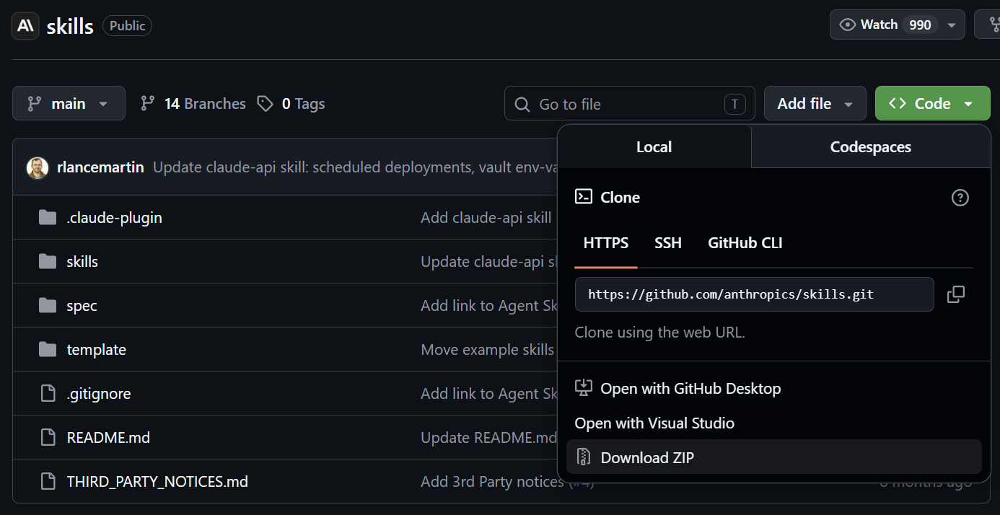
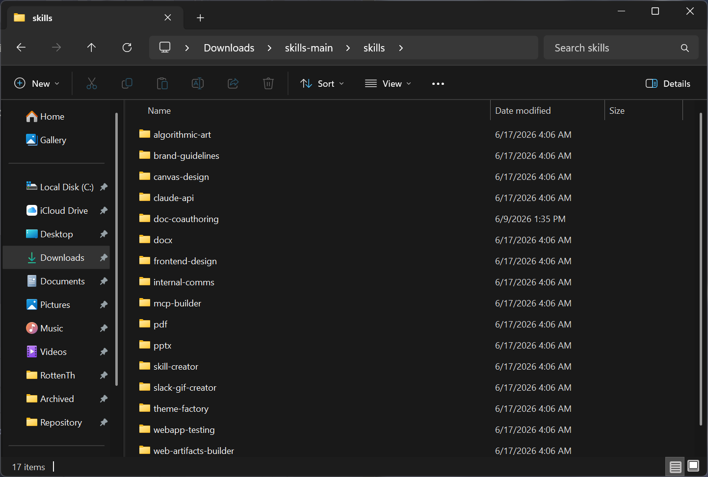
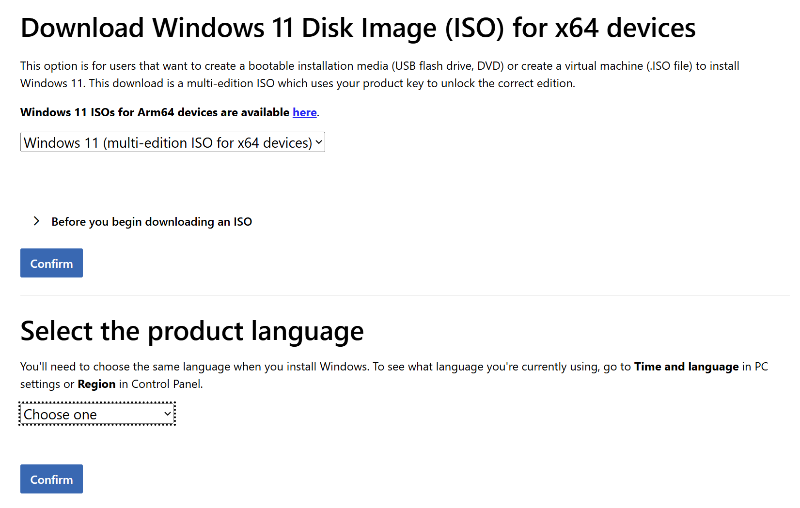

这篇文章把网站支持的写法都用了一遍，用来检查样式和组件。它是草稿，只在 `pnpm dev` 里出现；想发布就把 `draft` 改成 `false`。每种写法怎么写，见 Obsidian 里的《文章扩展写法》。

## 文字

普通段落里可以有**粗体**、*斜体*、~~删除线~~、`行内代码`、[站内链接](/about)和[外部链接](https://astro.build)。外部链接后面有一个箭头，在新标签页打开。

页面在服务器上生成，也就是 :term[SSR]{note="Server-Side Rendering"}。凶手是 :spoiler[管家]。这一句后面有一个脚注[^1]。

> 引用块。Make the small decisions once, then stop deciding.

---

### 列表

- 无序列表的第一项
- 第二项
  - 嵌套的一项

1. 有序列表的第一项
2. 第二项

- [x] 已完成的任务
- [ ] 没完成的任务

#### 四级标题

四级标题不进目录，旁边也有 “#” 锚点。

## 提示块

:::note
`note`：补充说明，不看也不影响。
:::

:::tip[自定义标题]
`tip`：带自己的标题。
:::

:::important
`important`：读者需要知道的事。
:::

:::warning
`warning`：可能出问题的地方。
:::

:::caution
`caution`：会造成损失的操作。
:::

:::details[点开看完整内容]
`details` 默认收起。加 `{open}` 就一开始展开。
:::

:::spoiler
整段剧透，点一下才显示。
:::

## 代码

```ts title="astro.config.ts" {3} showLineNumbers
import { defineConfig } from "astro/config";

export default defineConfig({
  site: "https://rottenth.cafe", // [!code ++]
  trailingSlash: "ignore" // [!code --]
});
```

:::code-group{sync="pkg"}
```sh title="pnpm"
pnpm add astro
```

```sh title="npm"
npm install astro
```
:::

:::code-group{sync="pkg"}
```sh title="pnpm"
pnpm dev
```

```sh title="npm"
npm run dev
```
:::

上面两个代码组的 `sync` 相同，切换一个，另一个跟着切。

:::file-tree{label="你的项目"}
- src/
  - pages/
    - index.astro
  - content.config.ts  新加的
- astro.config.ts
:::

## 步骤

:::steps{current=1}
1. 复制模板文件夹

   每一步的第一行是标题，后面是说明，可以放代码和图片。

2. 改配置

3. 构建并部署
:::

## 参数卡片

::::fields[Options]
:::field{name="build.format" type="'file' | 'directory'" required}
生成 `x.html` 还是 `x/index.html`。
:::

:::field{name="server.port" type="number" default="4321"}
开发服务器的端口。
:::
::::

## 表格

| 写法 | 组件 | 说明 |
| --- | --- | --- |
| 代码块 | `CodeBlock` | 文件名、行高亮、行号、增删标记 |
| 表格 | `TableScroll` | 每列至少 8rem，放不下时横向滚动 |
| 图片 | `Figure` | 图注、模糊占位、点击放大 |

## 图片



:::gallery{columns=2 ratio="4/3"}


:::

## 数学公式

行内公式 $E = mc^2$，单独一段的公式：

$$
\int_0^1 x^2 \, dx = \frac{1}{3} \tag{1}
$$

## 图表


## 嵌入

::video{src="https://www.bilibili.com/video/BV1xx411c7mD" title="B 站视频示例" caption="点了播放按钮才加载播放器"}

::github{repo="RottenSea/design-system"}

[^1]: 脚注的内容显示在文章末尾。
